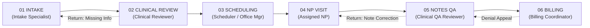
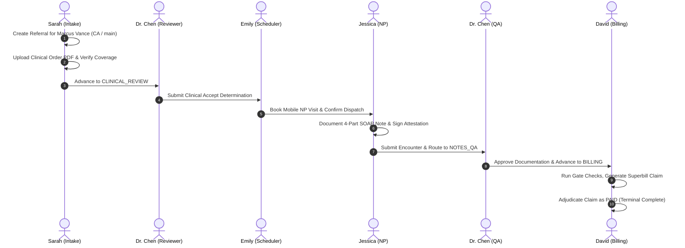
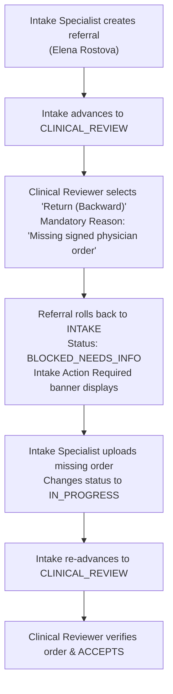

# 🏥 Heals on Wheels — Comprehensive Frontend Manual Testing Guide
### End-to-End Referral Workflow & Patient Pipeline Portal

---

## 📋 Table of Contents
1. [Document Overview & Testing Objectives](#1-document-overview--testing-objectives)
2. [Architecture & System Context](#2-architecture--system-context)
3. [Pre-Requisites & Environment Setup](#3-pre-requisites--environment-setup)
4. [User Personas & Role Access Matrix](#4-user-personas--role-access-matrix)
5. [The 4-Dimensional State Machine & Visual Rules](#5-the-4-dimensional-state-machine--visual-rules)
6. [Multi-Candidate Test Data Strategy](#6-multi-candidate-test-data-strategy)
7. [Sequential Step-by-Step Testing Process](#7-sequential-step-by-step-testing-process)
   - [Phase 1: System Admin & User Provisioning (`/admin/users`)](#phase-1-system-admin--user-provisioning)
   - [Phase 2: Candidate A (Marcus Vance) — Happy Path from Intake to Billed](#phase-2-candidate-a-marcus-vance--happy-path-end-to-end)
     - [Step 2.1: Intake Specialist — Patient Registration & Referral Creation (`/referrals/new`)](#step-21-intake-specialist--referral-creation)
     - [Step 2.2: Intake Specialist — Document Upload & Status Setting (`/referrals/[id]`)](#step-22-intake-specialist--document-upload--status)
     - [Step 2.3: Intake Specialist — Advance to Clinical Review](#step-23-intake-specialist--advance-to-clinical-review)
     - [Step 2.4: Clinical Reviewer — Medical Review & Determination Acceptance (`/referrals/[id]`)](#step-24-clinical-reviewer--clinical-determination)
     - [Step 2.5: Scheduler — Provider Territory Dispatch & Appointment Booking (`/schedule`)](#step-25-scheduler--provider-dispatch--booking)
     - [Step 2.6: Nurse Practitioner — Mobile In-Home Visit & Signed SOAP Note (`/visits`)](#step-26-nurse-practitioner--mobile-visit--soap-notes)
     - [Step 2.7: Clinical QA Reviewer — Notes Quality Audit & Advancement (`/notes-review`)](#step-27-clinical-qa-reviewer--notes-audit--advancement)
     - [Step 2.8: Billing Coordinator — Gate Checks, Superbill Claim & Remittance Adjudication (`/billing`)](#step-28-billing-coordinator--superbill-claim--payment)
   - [Phase 3: Candidate B (Elena Rostova) — Clinical Return to Intake Cycle](#phase-3-candidate-b-elena-rostova--clinical-return-cycle)
     - [Step 3.1: Intake Specialist — Create Referral](#step-31-create-referral-elena)
     - [Step 3.2: Clinical Reviewer — Flag Missing Order & Execute Return with Mandatory Reason](#step-32-clinical-return-with-mandatory-reason)
     - [Step 3.3: Cross-Portal Impact Verification — Intake Specialist Queue Reflection](#step-33-cross-portal-reflection-in-intake)
     - [Step 3.4: Intake Specialist — Attach Missing Order & Re-Submit](#step-34-intake-attach-order--resubmit)
     - [Step 3.5: Clinical Reviewer — Acceptance Verification](#step-35-clinical-acceptance-verification)
   - [Phase 4: Candidate C (David K. Miller) — Duplicate Detection & Terminal Rejection](#phase-4-candidate-c-david-k-miller--duplicate-detection--rejection)
     - [Step 4.1: Intake Specialist — Preemptive Duplicate Detection & 409 Conflict Dialog](#step-41-duplicate-detection-test)
     - [Step 4.2: Conflict Resolution Options (Link Existing vs Force Create)](#step-42-duplicate-conflict-resolution)
     - [Step 4.3: Clinical Reviewer — Execute Terminal Rejection with Audit Reason](#step-43-terminal-clinical-rejection)
   - [Phase 5: Candidate D (Sophia Bennett) — QA Note Return & Billing Denial/Appeal](#phase-5-candidate-d-sophia-bennett--qa-return--billing-denial)
     - [Step 5.1: Rapid Advance to Notes QA](#step-51-rapid-advance-to-notes-qa)
     - [Step 5.2: Clinical QA Reviewer — Return SOAP Note for Correction](#step-52-qa-return-soap-note)
     - [Step 5.3: Nurse Practitioner — Amend SOAP Documentation & Re-Sign](#step-53-np-amend-soap-note)
     - [Step 5.4: Clinical QA Reviewer — Approve Corrected Documentation](#step-54-qa-approve-corrected-note)
     - [Step 5.5: Billing Coordinator — Generate Claim & Adjudicate as Denied](#step-55-billing-mark-denied)
     - [Step 5.6: Billing Coordinator — Appeal Adjudication & Mark Paid](#step-56-billing-appeal--mark-paid)
8. [Interactive Board & Table Operations Testing (`/referrals`)](#8-interactive-board--table-operations-testing)
   - [View Toggle: Data Table vs Kanban Board](#view-toggle-table-vs-board)
   - [Drag-and-Drop Forward Progression](#drag-and-drop-forward)
   - [Drag-and-Drop Backward Rollback (Mandatory Reason Modal)](#drag-and-drop-rollback)
   - [Unauthorized Move Rejection (Server-Side Gate & Toast Verification)](#unauthorized-drag-attempt)
   - [Multi-Filter & Quick Tab Testing](#multi-filter-testing)
   - [Referral Quick Drawer (Comments, Documents, Workflow Gates)](#referral-quick-drawer)
9. [Patient Master Directory & Demographics (`/patients` & `/patients/[id]`)](#9-patient-master-directory)
10. [Notifications & Real-Time Alert Bell (`/notifications`)](#10-notifications--operational-alerts)
11. [HIPAA Audit Ledger & Surveillance (`/admin/audit`)](#11-hipaa-audit-ledger)
12. [Manual Testing Pass / Fail Sign-Off Sheet](#12-manual-testing-pass--fail-sign-off-sheet)

---

## 1. Document Overview & Testing Objectives

This manual testing guide provides a **page-by-page, role-by-role, and button-by-button** roadmap for executing full manual quality assurance of the **Heals on Wheels Healthcare Operations Platform**.

### Why This Guide Is Necessary
The platform is a multi-role, enterprise-scale clinical operating system implementing strict HIPAA boundaries, multi-site territorial scoping, optimistic concurrency control (OCC version ledgering), and an authoritative 6-stage clinical state machine. Because actions performed by one role (e.g., an Intake Specialist) directly trigger state changes, queue updates, badge alerts, and lock constraints in other roles' workspaces (e.g., Clinical Reviewers, Schedulers, Nurse Practitioners, Billing Coordinators), manual testing requires a **coordinated, sequential sequence across all user accounts**.

### Core Testing Goals
1. **Verify Complete End-to-End Life Cycle:** Follow patient referrals from intake document ingestion through clinical review, mobile dispatch, encounter notes, QA audit, and claim reimbursement.
2. **Verify All Role Permissions (RBAC):** Confirm that actions restricted to licensed clinicians (e.g., clinical review determinations, digital SOAP signing, notes QA approvals) cannot be bypassed by unprivileged roles.
3. **Verify State Machine Gates:** Confirm that cases cannot advance without fulfilling prerequisite stage gates (e.g., missing insurance coverage blocks clinical review; missing signed SOAP note blocks notes QA; unapproved QA blocks billing).
4. **Verify Exception & Rollback Flows:** Test clinical returns, QA note corrections, terminal rejections, duplicate patient resolutions, and insurance claim denials.
5. **Verify Cross-Portal Synchronization:** Validate that when an action is taken in one portal, the respective counters, badges, and queues in other portals update accurately.

---

## 2. Architecture & System Context

| Service | Technology | Port / URL | Description |
|---|---|---|---|
| **Frontend Web App** | Next.js 14/15, React 19, Tailwind CSS, TanStack Query v5 | `http://localhost:3000` | Modern, responsive clinical interface with role-based routing and accessible Kanban |
| **Backend REST API** | NestJS, TypeScript, Prisma ORM, Passport JWT | `http://localhost:3001` | Authoritative state machine engine, RBAC enforcement, OCC version control |
| **Database** | PostgreSQL | Port 5432 (Cloud/Render) | ACID transactional store for patients, referrals, notes, encounters, claims, audit events |
| **Cache & Real-Time** | Redis + Socket.io | Port 6379 | Session tokens, permission caching, real-time WebSocket transition broadcast |

---

## 3. Pre-Requisites & Environment Setup

Before starting manual testing, ensure both the backend API and frontend web services are running.

### Step 1: Open Terminal 1 — Start the Backend API
```powershell
cd e:\refferal-os-workflow
npm run dev:api
```
*Expected Console Output:*
`[NestApplication] Nest application successfully started on port 3001`

### Step 2: Open Terminal 2 — Start the Frontend Web App
```powershell
cd e:\refferal-os-workflow
npm run dev:web
```
*Expected Console Output:*
`- Local: http://localhost:3000`

### Step 3: Open Browser Windows / Testing Setup
- **Recommended Setup:** Open your primary browser (e.g., Google Chrome).
- **Pro Testing Tip:** To test real-time cross-role updates without repeatedly logging in and out, open two separate browser sessions:
  - **Window 1 (Normal Window):** Log in as **Sarah Johnson** (Intake Specialist) or **Dr. Michael Chen** (Clinical Reviewer).
  - **Window 2 (Incognito / Private Window):** Log in as **Emily Rodriguez** (Scheduler) or **NP Jessica Williams** (Nurse Practitioner).

---

## 4. User Personas & Role Access Matrix

The system includes **6 pre-configured personas** in the database seed. All accounts share the same default test password.

| Persona Name | Role | Email | Password | Primary Workspace / Default Route | Permitted Stage Actions |
|---|---|---|---|---|---|
| **System Administrator** | `ADMIN` | `admin@heals.health` | `Admin@2024!` | `/admin/users` (Global Switcher) | Global operational override; User & scope management; Audit surveillance. *Note: Clinical note sign-off strictly requires licensed clinical credentials per HIPAA regulations.* |
| **Sarah Johnson** | `INTAKE_SPECIALIST` | `intake@heals.health` | `Admin@2024!` | `/referrals?pipelineStage=INTAKE` | Create referrals; Upload & verify documents; Resolve duplicates; Advance INTAKE → CLINICAL_REVIEW. |
| **Dr. Michael Chen** | `CLINICAL_REVIEWER` | `reviewer@heals.health` | `Admin@2024!` | `/referrals?pipelineStage=CLINICAL_REVIEW` | Clinical determination (Accept / Return / Reject); Audit encounter notes QA (`/notes-review`). |
| **Emily Rodriguez** | `SCHEDULER` | `scheduler@heals.health` | `Admin@2024!` | `/schedule` | Book mobile NP visits; Match patient territory with licensed clinician; Advance SCHEDULING → NP_VISIT. |
| **NP Jessica Williams** | `NURSE_PRACTITIONER` | `np@heals.health` | `Admin@2024!` | `/visits` | Conduct mobile in-home evaluations; Draft 4-part SOAP notes; Digital provider signing & attestation. |
| **David Martinez** | `BILLING_COORDINATOR`| `billing@heals.health` | `Admin@2024!` | `/billing` | Review billing readiness checklist; Generate superbills; Submit electronic claims; Adjudicate Paid/Denied. |

> [!TIP]
> **One-Click Persona Login:** On the login page (`/login`), the right-hand panel displays **Demo Persona Cards** with a **"Quick Sign In"** button for each role. Clicking "Quick Sign In" automatically fills credentials and logs you in instantly!

---

## 5. The 4-Dimensional State Machine & Visual Rules

Every referral in the platform is tracked across **four independent dimensions**:



### 1. Dimension 1: `pipelineStage` (WHERE the case is located)
1. `INTAKE` (01 Intake & Eligibility Triage)
2. `CLINICAL_REVIEW` (02 Pre-Visit Clinical Review)
3. `SCHEDULING` (03 Provider Dispatch & Appointment Booking)
4. `NP_VISIT` (04 Mobile Nurse Practitioner Encounter)
5. `NOTES_QA` (05 Post-Visit Clinical Notes Review)
6. `BILLING` (06 Superbill Generation & Claims Adjudication)

### 2. Dimension 2: `workStatus` (HOW the work is progressing)
- **`PENDING` (Slate / Grey):** Case is waiting for stage owner to commence work.
- **`IN_PROGRESS` (Blue):** Actively being worked on by the stage owner.
- **`ON_HOLD` (Amber / Orange):** Paused; requires a documented hold reason and follow-up date.
- **`BLOCKED_NEEDS_INFO` (Red / Rose):** Missing clinical documentation, eligibility issue, or returned from downstream review.
- **`COMPLETED` (Green / Emerald):** All mandatory tasks in current stage are finished; case is ready to advance.

### 3. Dimension 3: `caseOutcome`
- `ACTIVE` (Ongoing referral in active lifecycle)
- `REJECTED` (Clinically ineligible or out of service territory — terminal closed)
- `DISCHARGED` (Completed episode of home health care)
- `DUPLICATE` (Merged or linked to existing patient chart)

### 4. Dimension 4: `billingStatus`
- `NOT_READY` → `READY` (Unlocked upon Notes QA approval) → `SUBMITTED` → `PAID` (or `DENIED` / `REJECTED`)

---

## 6. Multi-Candidate Test Data Strategy

To verify all features, conditions, and branches of the system, you will test using **4 distinct candidate cases**:

```
┌────────────────────────────────────────────────────────────────────────────────────────┐
│                              TEST CANDIDATE SUITE                                      │
├─────────────────┬──────────────────────┬───────────────────────┬───────────────────────┤
│ Candidate A     │ Candidate B          │ Candidate C           │ Candidate D           │
│ Marcus Vance    │ Elena Rostova        │ David K. Miller       │ Sophia Bennett        │
├─────────────────┼──────────────────────┼───────────────────────┼───────────────────────┤
│ • Happy Path    │ • Clinical Return    │ • Duplicate Conflict  │ • QA Note Return      │
│ • End-to-End    │ • Missing Order      │ • Match Scoring       │ • SOAP Amendment      │
│ • Intake → Paid │ • Re-submission      │ • Terminal Rejection  │ • Claim Denial/Appeal │
└─────────────────┴──────────────────────┴───────────────────────┴───────────────────────┘
```

---

## 7. Sequential Step-by-Step Testing Process

---

### Phase 1: System Admin & User Provisioning

**Objective:** Verify administrative user oversight, site scopes, security logs, and role permissions.

#### Step 1.1: Sign In as System Administrator
1. Open your browser and navigate to `http://localhost:3000/login`.
2. Look at the left card titled **"Clinical Portal Sign In"**.
   - **Work Email:** Enter `admin@heals.health`
   - **Password:** Enter `Admin@2024!`
   - *(Or simply click the **"Quick Sign In"** button on the "System Administrator" card in the right column).*
3. Click the dark button **"Sign in to Clinical Portal"**.
4. **Expected Result:**
   - A green toast message appears: `"Welcome back, System Administrator"`.
   - The browser automatically navigates to `/admin/users`.
   - The top header shows your profile pill with initials **SA** and badge **"System Admin"**.
   - A **Workspace Switcher** dropdown appears in the top navigation bar with access to all 9 workspaces.

#### Step 1.2: Inspect the User Management Directory (`/admin/users`)
1. **Screen Location:** Center table listing registered staff accounts.
2. **Verify User Table Columns:**
   - Verify all 6 seed users appear: System Administrator, Sarah Johnson, Dr. Michael Chen, Emily Rodriguez, NP Jessica Williams, David Martinez.
   - Verify columns: **Staff Member**, **Assigned Role**, **Operational Scopes (Site / State)**, **Account Status**, and **Actions**.
3. **Test Search / Filter:**
   - In the search input located at top-left (`"Search users by name or email..."`), type `Jessica`.
   - **Expected Result:** Table immediately filters down to show only **NP Jessica Williams**.
   - Clear the search box.

#### Step 1.3: Test Staff Invitation Modal
1. **Button Location:** Top-right corner of `/admin/users` page — blue/primary button titled **"+ Invite New Staff"**.
2. Click **"+ Invite New Staff"**.
3. A modal dialog titled **"Invite New Workforce Member"** will pop up with fields:
   - **First Name:** Type `Rachel`
   - **Last Name:** Type `Green`
   - **Work Email:** Type `rachel.green@heals.health`
   - **Clinical Role Dropdown:** Click dropdown and select `INTAKE_SPECIALIST`
   - **Primary Site Territory:** Select `main — Primary HQ / Clinic (California)`
   - **Jurisdiction State:** Select `California (CA)`
4. Click the dark button at bottom-right of the dialog: **"Send Secure Invitation"**.
5. **Expected Result:**
   - Success toast appears: `"Invitation sent! An email with the setup link has been delivered."`
   - Modal closes, and `rachel.green@heals.health` appears in the user list with badge `INVITED`.

#### Step 1.4: Test Account Suspension & Reactivation
1. Locate the row for `rachel.green@heals.health`.
2. On the far right under **Actions**, click the red icon/button **"Suspend"** (shield with slash).
3. A confirmation dialog appears: **"Suspend User Account"**. Click **"Confirm Suspension"**.
4. **Expected Result:**
   - Toast notification: `"User suspended. Active sessions and Redis tokens immediately terminated."`
   - Status badge changes from green `ACTIVE` to red `SUSPENDED`.
5. Click the green icon/button **"Reactivate"** to restore access.

---

### Phase 2: Candidate A (Marcus Vance) — Happy Path End-to-End



---

#### Step 2.1: Intake Specialist — Referral Creation
*Persona:* **Sarah Johnson** (`intake@heals.health`)

1. **Sign In as Intake Specialist:**
   - Log out (click profile avatar at top-right → **"Log Out"**).
   - On `/login`, click **"Quick Sign In"** on the **Sarah Johnson** card.
   - Notice you are directed straight to **Intake Workspace** (`/referrals?pipelineStage=INTAKE`).
2. **Navigate to Referral Creation Form:**
   - Click the blue button **"+ Create Referral"** at the top right of the page (or click **"New Referral"** in the left sidebar, keyboard shortcut `N`).
   - You arrive at `/referrals/new`.
3. **Card 1: Patient Identification:**
   - Mode Toggle: Ensure **"New Patient"** is selected (default).
   - **First Name *:** Type `Marcus`
   - **Last Name *:** Type `Vance`
   - **Date of Birth *:** Type or select `1958-04-12`
   - **Phone Number:** Type `(310) 555-0199`
   - **MRN (Medical Record #):** Type `MRN-MV-9821`
   - **Email:** Type `marcus.vance@example.com`
4. **Card 2: Clinical Referral Classification:**
   - **Priority Dropdown:** Select `ROUTINE`
   - **Referral Source:** Type `Cedars-Sinai Medical Center`
   - **Referring Physician / Clinician:** Type `Dr. Robert Sterling, MD`
   - **Referring Facility / Clinic:** Type `Cedars-Sinai Inpatient Discharge Unit`
   - **Primary Insurance Payer:** Type `Blue Shield of California`
   - **Clinical Notes / Reason for Referral:** Type:
     > `Patient is a 66-year-old male with chronic non-healing diabetic ulcer on left plantar heel (Wagner Stage 2). Requires mobile in-home wound debridement and nurse practitioner clinical management.`
5. **Submit Referral:**
   - Click the blue button at the bottom: **"Create Referral & Initiate Intake"**.
   - **Expected Result:**
     - Success toast appears: `"Referral Created Successfully — Referral is now in INTAKE stage awaiting document verification."`
     - You are immediately redirected to the Referral Detail Page: `/referrals/[id]`.

---

#### Step 2.2: Intake Specialist — Document Upload & Status
*Page:* `/referrals/[id]` (Marcus Vance)

1. **Verify Header & Lifecycle Stepper:**
   - Patient heading: **Marcus Vance**
   - Clickable tracking button (e.g., `REF-XXXXXX`) with copy feedback.
   - Badges: Priority `ROUTINE` (blue), Stage `01 INTAKE` (blue), Status `IN PROGRESS` (blue).
   - Stepper: Gate `01 Intake Triage` is highlighted in blue with a pulsing dot. Gates 02 to 06 are grey.
2. **Test Quick Status Modifier:**
   - Under **Operational Gate Controls**, click the button **"In Progress"**.
   - Notice toast: `"Work status updated"`.
3. **Upload Clinical Document:**
   - Click the **"Documents"** tab (second tab under the stepper).
   - Under **Attached Clinical Documents**:
     - Click **"Choose File"** (or drag any small sample PDF or image from your computer).
     - In the **Document Type** dropdown, select `Clinical Order`.
     - Click the blue button **"Upload & Extract"**.
   - **Expected Result:**
     - Green toast: `"Document uploaded and queued for AI extraction"`.
     - The document appears in the list below with file name, type `CLINICAL_ORDER`, date, and badge `Pending Verification`.
     - Test the download button (down-arrow icon) — verifies secure blob download.

---

#### Step 2.3: Intake Specialist — Advance to Clinical Review
1. **Locate Transition Button:**
   - Look at the top **Operational Gate Controls** card on the right-hand side.
   - Locate the button: **"Submit Intake & Advance to Clinical Review →"**.
2. **Click the Button:**
   - Click **"Submit Intake & Advance to Clinical Review →"**.
3. **Expected Result:**
   - Green toast: `"Referral moved to CLINICAL REVIEW"`.
   - The Stage badge updates to `02 CLINICAL REVIEW`.
   - Stepper updates: Gate 01 shows a green checkmark `✓`, and Gate `02 Clinical Review` becomes the active pulsing blue step.
   - A lock banner appears: `"Intake Baseline Locked: Patient demographics, payer details, and initial referral documentation are locked while this referral is in CLINICAL REVIEW."`
4. **Cross-Portal Impact:**
   - Sarah Johnson's Intake Queue counter decreases by 1.
   - Dr. Michael Chen's Clinical Review Queue counter increases by 1!

---

#### Step 2.4: Clinical Reviewer — Clinical Determination
*Switch Role:* Log out and log in as **Dr. Michael Chen** (`reviewer@heals.health`)

1. **Sign In as Clinical Reviewer:**
   - Log in using Dr. Chen's credentials (or click **"Quick Sign In"** on Dr. Michael Chen's card).
   - You land directly on the **Clinical Review Queue** (`/referrals?pipelineStage=CLINICAL_REVIEW`).
2. **Open Marcus Vance's Referral:**
   - In the referrals table, locate **Marcus Vance** (Tracking # `REF-XXXXXX`).
   - Click on the row (or click the eye icon / view button) to open `/referrals/[id]`.
3. **Review Clinical Order & History:**
   - View the **"Overview & Clinical Notes"** tab: confirm diabetic ulcer diagnosis and Dr. Sterling's order.
   - View the **"Documents"** tab: confirm the uploaded clinical order.
4. **Locate the Formal Clinical Determination Panel:**
   - In the **Operational Gate Controls** card, observe the special section: **"Formal Clinical Review Determination"** with badge `Clinical Action Required`.
   - Observe the **3 Decision Cards**:
     1. `Accept (Forward)` (Green border)
     2. `Return (Backward)` (Amber border)
     3. `Reject (Decline)` (Rose border)
5. **Select Decision Path:**
   - Click the green card: **"Accept (Forward)"**.
   - The card highlights with a green ring and background.
6. **Enter Acceptance Justification:**
   - In the text input below the cards (*"Enter clinical acceptance justification..."*), type:
     > `Clinical eligibility criteria satisfied. Patient is homebound due to Wagner Stage 2 diabetic plantar ulcer. Mobile NP wound care evaluation approved.`
7. **Submit Clinical Determination:**
   - Click the green button: **"Submit Acceptance"**.
8. **Expected Result:**
   - Green toast: `"Clinical Review recorded: ACCEPT"`.
   - The referral transitions to `03 SCHEDULING`.
   - Stepper: Gate 01 & Gate 02 both show green checkmarks `✓`. Gate `03 NP Scheduling` is now active.
9. **Cross-Portal Impact:**
   - Case is removed from Dr. Chen's Clinical Review queue.
   - Case appears in Emily Rodriguez's Scheduling Dispatch queue (`/schedule`)!

---

#### Step 2.5: Scheduler — Provider Dispatch & Booking
*Switch Role:* Log out and log in as **Emily Rodriguez** (`scheduler@heals.health`)

1. **Sign In as Scheduler:**
   - Click **"Quick Sign In"** on **Emily Rodriguez's** card.
   - You land on `/schedule` (**Provider Dispatch & Scheduling**).
2. **Observe Screen Layout:**
   - **Left Column:** **Awaiting Dispatch (count)** card displaying referrals currently in `SCHEDULING` stage.
   - **Right Column:** **Scheduled Clinical Appointments** card showing existing bookings.
3. **Locate Marcus Vance:**
   - In the left column, locate the card for **Marcus Vance** (`REF-XXXXXX`).
4. **Open Booking Form:**
   - Click the blue button at top-right: **"+ Book Mobile Visit"**.
   - An expanded card appears: **"Schedule Mobile Nurse Practitioner Visit"**.
5. **Fill Appointment Details:**
   - **Select Referral in SCHEDULING Stage *:** Open dropdown and select `Marcus Vance (main)`.
   - **Date & Time *:** Select tomorrow at `10:00 AM` (e.g. `2026-11-12T10:00`).
   - **Visit Location:** Verify pre-filled `Patient Residence (Mobile Visit)` or enter `123 Main St, Los Angeles, CA`.
   - **Scheduling Notes / Instructions:** Type:
     > `Caregiver present. Gated entry code #4491. Bring wound care debridement kit.`
6. **Confirm Booking:**
   - Click the blue button: **"Confirm Appointment Booking"**.
7. **Expected Result:**
   - Green toast: `"Appointment Booked Successfully"`.
   - The booking form closes.
   - Marcus Vance's appointment appears in the right column under **Scheduled Clinical Appointments** with status badge `SCHEDULED`.
8. **Dispatch to NP Visit Stage:**
   - Click on **Marcus Vance** in the schedule list to open his detail page `/referrals/[id]`.
   - In the **Operational Gate Controls**, click the blue button: **"Confirm & Dispatch NP Visit →"**.
   - **Expected Result:**
     - Toast: `"Referral moved to NP VISIT"`.
     - Stage badge becomes `04 NP VISIT`.
9. **Cross-Portal Impact:**
   - Case moves into NP Jessica Williams' Mobile Visit queue (`/visits`)!

---

#### Step 2.6: Nurse Practitioner — Mobile Visit & SOAP Notes
*Switch Role:* Log out and log in as **NP Jessica Williams** (`np@heals.health`)

1. **Sign In as Nurse Practitioner:**
   - Click **"Quick Sign In"** on **NP Jessica Williams'** card.
   - You land on `/visits` (**Nurse Practitioner Clinical Encounters**).
2. **Select Patient Encounter:**
   - In the left queue **"Pending Visits"**, locate **Marcus Vance**.
   - Click on Marcus Vance's card (or click **"Document Visit"**).
   - Marcus Vance's card highlights in blue with indicator `"Currently Documenting"`.
3. **Review the SOAP Note Workspace (Right Column):**
   - The heading displays: `"Documenting visit for: Marcus Vance (REF-XXXXXX)"`.
   - **Date of Service *:** Confirm today's date (defaults to today).
   - **Services Provided:** `Comprehensive Mobile Clinical Assessment, Wound Debridement Wagner Stage 2`
4. **Enter Complete 4-Part SOAP Note:**
   - **Subjective (S):**
     > `Patient reports 3-week history of worsening left heel pain and drainage. Discomfort increased with weight-bearing. Denies fever or chills. History of Type 2 Diabetes.`
   - **Objective (O):**
     > `BP 128/82, HR 74, Temp 98.4°F. Left plantar heel reveals 2.5cm x 1.8cm ulcer, depth 0.4cm. Wound bed 80% granulation, 20% slough. Surrounding skin erythematous. Mild serosanguinous drainage, no purulence.`
   - **Assessment (A):**
     > `1. Wagner Stage 2 chronic diabetic ulcer of left heel (ICD-10: E11.621, L97.422). 2. Type 2 Diabetes Mellitus with diabetic neuropathy.`
   - **Plan (P):**
     > `Performed sharp debridement of non-viable tissue. Cleansed with sterile normal saline. Applied hydrogel dressing and sterile foam wrap. Offloading diabetic boot instructed. NP wound check scheduled in 7 days.`
5. **Verify Digital Signature & Attestation:**
   - Verify the signature input is pre-populated: `NP Jessica Williams, MSN, APRN, FNP-C (NPI: 1827364590)`.
   - Notice the note: *"Signing locks note revision immutably and immediately routes case to Notes QA Review."*
6. **Submit Signed Encounter:**
   - Click the green/primary button at bottom-right: **"Sign & Route to Notes QA"**.
7. **Expected Result:**
   - Green toast: `"Clinical Encounter & Signed SOAP Note Submitted for Notes QA!"`.
   - The left queue updates: Marcus Vance is removed from Pending Visits.
8. **Cross-Portal Impact:**
   - Referral advances to `05 NOTES_QA`.
   - Case instantly appears in the Clinical QA Review queue (`/notes-review`)!

---

#### Step 2.7: Clinical QA Reviewer — Notes Audit & Advancement
*Switch Role:* Log out and log in as **Dr. Michael Chen** (`reviewer@heals.health`)

1. **Sign In as Clinical Reviewer / QA:**
   - Click **"Quick Sign In"** on **Dr. Michael Chen's** card.
2. **Navigate to Notes QA Review:**
   - In the left sidebar, click **"Clinical Notes QA"** (or go to `/notes-review`).
   - Notice the sidebar badge shows `1` pending note.
3. **Select Marcus Vance for Audit:**
   - In the left queue **"Awaiting QA"**, locate **Marcus Vance**.
   - Click **"Review Documentation"**.
4. **Audit the Documentation Panel (Right Column):**
   - Heading: `Auditing note for: Marcus Vance (REF-XXXXXX)`.
   - Notice the green badge: `Signed & Locked`.
   - Notice the attestation card: `✓ Signed by Nurse Practitioner (Credential verified)`.
   - Review the complete SOAP note contents displayed on screen.
5. **Add QA Audit Findings:**
   - In the textarea **"QA Audit Findings & Review Notes"**, type:
     > `Documentation satisfies all clinical quality criteria. ICD-10 coding (E11.621, L97.422) verified against clinical description. Treatment protocol and medical necessity substantiated. Approved for billing.`
6. **Approve Documentation:**
   - Click the dark button at bottom-right: **"Approve & Advance to Billing"**.
7. **Expected Result:**
   - Green toast: `"Note Approved! Referral progressed to BILLING stage."`.
   - Marcus Vance clears from the QA queue.
8. **Cross-Portal Impact:**
   - Referral stage advances to `06 BILLING`.
   - Referral `billingStatus` changes to `READY`!
   - Case appears in David Martinez's **Billing Ready Queue** (`/billing`)!

---

#### Step 2.8: Billing Coordinator — Superbill Claim & Payment
*Persona:* **David Martinez** (`billing@heals.health`)

1. **Sign In as Billing Coordinator:**
   - Click **"Quick Sign In"** on **David Martinez's** card.
   - You land directly on `/billing` (**Revenue Cycle & Claims Adjudication**).
2. **Locate Marcus Vance in Billing Ready Queue:**
   - In the left column **"Billing Ready Queue"**, locate **Marcus Vance**.
   - Notice the subtext: `Site: main • QA Approved` in green.
   - Click **"Create Superbill"**.
3. **Inspect the Billing Readiness Gate Checklist:**
   - In the right column, verify the 4 green checkmarks:
     - `✓ Coverage Verified Active`
     - `✓ Signed SOAP Note Locked`
     - `✓ Notes QA Reviewed & Approved`
     - `✓ Provider NPI Validated`
4. **Configure Superbill Codes & Charge:**
   - **CPT / Billing Codes *:** Verify or type `99349, 97597 (Home Visit Level 4, Active Wound Care Debridement)`
   - **Charge Amount ($ USD) *:** Enter `345.00`
5. **Generate Claim:**
   - Click the dark button: **"Generate Superbill & Dispatch Claim"**.
   - **Expected Result:**
     - Green toast: `"Superbill Claim Generated & Marked READY for Submission!"`.
     - Marcus Vance clears from the Billing Ready queue.
6. **Adjudicate Claim in Remittance Ledger:**
   - Scroll down to the bottom card: **"Processed Claims & Remittance Adjudication"**.
   - Locate Marcus Vance's new claim row with charge `$345.00`.
   - Under Actions, click the green button **"Mark Paid"**.
   - A confirmation dialog appears: **"Mark Claim as Paid"** (Check Reference: `REM-XXXXXX`). Click **"Confirm Payment"**.
7. **Expected Result:**
   - Toast: `"Claim adjudicated as PAID"`.
   - Claim badge turns green `PAID`.
   - Referral case reaches its terminal completed state.
   - **🎉 Complete Happy Path for Candidate A verified successfully!**

---

### Phase 3: Candidate B (Elena Rostova) — Clinical Return Cycle

**Objective:** Verify exception handling when a Clinical Reviewer identifies missing clinical documentation and executes a backward return to Intake with a mandatory clinical reason.



---

#### Step 3.1: Create Referral (Elena Rostova)
*Log in as Sarah Johnson (`intake@heals.health`)*
1. Go to `/referrals/new`.
2. Enter demographics:
   - **First Name:** `Elena`
   - **Last Name:** `Rostova`
   - **DOB:** `1972-09-18`
   - **Phone:** `(415) 555-0248`
   - **MRN:** `MRN-ER-5512`
   - **Priority:** `URGENT`
   - **Referral Source:** `St. Luke's Health Center`
   - **Insurance Payer:** `Medicare Part B`
   - **Notes:** `Severe peripheral edema with stasis dermatitis. Inability to ambulate to clinic.`
3. Click **"Create Referral & Initiate Intake"**.
4. In `/referrals/[id]`, without uploading any document, click **"Submit Intake & Advance to Clinical Review →"**.
5. Referral moves to `02 CLINICAL_REVIEW`.

---

#### Step 3.2: Clinical Return with Mandatory Reason
*Log in as Dr. Michael Chen (`reviewer@heals.health`)*
1. Go to `/referrals` (or open Elena Rostova from the Clinical Review queue).
2. Open Elena Rostova's detail page `/referrals/[id]`.
3. In **Operational Gate Controls**:
   - In the **Formal Clinical Review Determination** section, click the amber card: **"Return (Backward)"**.
   - Notice the explanation text: *"Missing clinical order or notes. Returns case to Intake for provider follow-up."*
4. **Test Mandatory Reason Gate:**
   - Leave the text input blank and click **"Submit Return to Intake"**.
   - **Expected Result:** Red error toast: `"Clinical Rationale Required — A documented reason is mandatory when choosing to return this referral."`
5. **Enter Clinical Return Reason:**
   - In the text box, type:
     > `Missing signed physician order. Face-to-face encounter documentation is required prior to scheduling mobile clinical dispatch.`
   - Click the amber button: **"Submit Return to Intake"**.
6. **Expected Result:**
   - Toast: `"Clinical Review recorded: RETURN"`.
   - The stage rolls back from `02 CLINICAL_REVIEW` to `01 INTAKE`.
   - The work status updates to `BLOCKED_NEEDS_INFO`.

---

#### Step 3.3: Cross-Portal Reflection in Intake
*Log in as Sarah Johnson (`intake@heals.health`)*
1. Open Elena Rostova's detail page `/referrals/[id]`.
2. Notice the prominent amber alert banner at the top:
   > ⚠️ **Intake Action Required:** *This referral is flagged as Needs Info / Returned from Clinical Review. Please attach the required clinical order or clarify payer coverage before re-advancing.*
3. Click the **"Audit Timeline"** tab:
   - Verify the audit log captures Dr. Chen's exact return reason: `"Missing signed physician order..."`.

---

#### Step 3.4: Intake Attach Order & Re-Submit
1. Click the **"Documents"** tab.
2. Select a file from your computer, choose document type `Clinical Order`, and click **"Upload & Extract"**.
3. Under **Operational Gate Controls**, click **"In Progress"** to clear the blocked status.
4. Click **"Submit Intake & Advance to Clinical Review →"**.
5. Referral advances back to `02 CLINICAL_REVIEW`.

---

#### Step 3.5: Clinical Acceptance Verification
*Log in as Dr. Michael Chen (`reviewer@heals.health`)*
1. Open Elena Rostova's detail page.
2. Verify the newly uploaded order is visible under the **"Documents"** tab.
3. Click **"Accept (Forward)"**, enter note: `Physician order verified and authenticated. Approved for scheduling.`, and click **"Submit Acceptance"**.
4. **Expected Result:** Referral advances smoothly to `03 SCHEDULING`!

---

### Phase 4: Candidate C (David K. Miller) — Duplicate Detection & Rejection

**Objective:** Test the platform's AI/algorithm-driven duplicate patient matching, conflict resolution dialog, and terminal clinical rejection path.

---

#### Step 4.1: Duplicate Detection Test
*Log in as Sarah Johnson (`intake@heals.health`)*
1. Go to `/referrals/new`.
2. Enter patient details matching existing seed patient **John Doe**:
   - **First Name:** `John`
   - **Last Name:** `Doe`
   - **DOB:** `1980-01-15`
   - **Phone:** `555-0100`
3. Notice that as you finish entering the Date of Birth, a subtle preemptive duplicate detection call runs in the background.
4. Enter referral details:
   - **Priority:** `ROUTINE`
   - **Referral Source:** `General Hospital`
   - **Insurance Payer:** `Aetna`
5. Click **"Create Referral & Initiate Intake"**.

---

#### Step 4.2: Duplicate Conflict Resolution
1. **Expected Result:**
   - A modal dialog appears: **"Potential Duplicate Patient Detected"**.
   - Displays match percentage/score (e.g. `95% Match Score`) with reasons: `First name match`, `Last name match`, `DOB exact match`.
   - Displays two clear action buttons:
     - **Button A:** `"Link to Existing Patient (John Doe, MRN001234)"`
     - **Button B:** `"Force Create New Patient Chart"`
2. Click **"Link to Existing Patient"**.
3. **Expected Result:**
   - The form switches to **"Existing Patient"** mode with John Doe selected.
   - Submit the referral to confirm creation without duplicate chart clutter.

---

#### Step 4.3: Terminal Clinical Rejection
*Scenario: Now test a referral that is outside the licensed service area.*
1. Create a new referral for:
   - **First Name:** `David`
   - **Last Name:** `Miller`
   - **DOB:** `1960-03-22`
   - **Referral Source:** `Nevada Outpatient Clinic`
   - **Notes:** `Patient resides in Reno, Nevada. Requesting California mobile NP visit.`
2. Advance David Miller to `02 CLINICAL_REVIEW`.
3. Switch role to **Dr. Michael Chen** (`reviewer@heals.health`).
4. Open David Miller's detail page.
5. In **Formal Clinical Review Determination**:
   - Click the red card: **"Reject (Decline)"**.
   - In the justification input, type:
     > `Declined: Patient physical residence is in Nevada, which is outside the licensed geographic territory of our California clinical provider group.`
   - Click the red button: **"Submit Rejection"**.
6. **Danger Confirmation Dialog:**
   - A modal dialog appears with a red shield icon: **"Reject Clinical Referral"**.
   - Warning text: *"Rejecting referral permanently closes the case with status REJECTED. This decision is immutably recorded in the compliance audit log and cannot be undone."*
   - Click the red button: **"Reject Referral"**.
7. **Expected Result:**
   - Case status becomes `REJECTED`.
   - Case outcome is recorded as terminal closure.
   - Drag controls and forward advance buttons are permanently disabled.

---

### Phase 5: Candidate D (Sophia Bennett) — QA Return & Billing Denial

**Objective:** Test post-visit QA correction routing back to the Nurse Practitioner, digital re-signing, and insurance billing denial/appeal workflow.

---

#### Step 5.1: Rapid Advance to Notes QA
1. Register patient **Sophia Bennett** (`1985-07-14`, Routine, Care Coordination).
2. Upload clinical order and advance to `CLINICAL_REVIEW`.
3. As Dr. Chen, click **"Accept (Forward)"** → advances to `SCHEDULING`.
4. As Emily Rodriguez, book visit on `/schedule` → dispatch to `NP_VISIT`.
5. As NP Jessica Williams, open `/visits`, select Sophia Bennett, enter SOAP note, and click **"Sign & Route to Notes QA"**.

---

#### Step 5.2: QA Return SOAP Note
*Log in as Dr. Michael Chen (`reviewer@heals.health`)*
1. Navigate to `/notes-review`.
2. Select **Sophia Bennett** from the **Awaiting QA** queue.
3. Review her encounter documentation.
4. Click the amber button: **"Return for Correction"**.
5. A confirmation dialog appears: **"Return Clinical Note for Correction"**.
   - Input field: **Mandatory Clinical Correction Guidance \***
   - Enter: `Missing ICD-10 diagnosis code for secondary hypertension. Please amend Assessment section and re-sign.`
   - Click **"Return for Correction"**.
6. **Expected Result:**
   - Toast: `"Note Returned to Nurse Practitioner for corrections."`
   - Referral rolls back from `05 NOTES_QA` to `04 NP_VISIT`.

---

#### Step 5.3: NP Amend SOAP Note
*Log in as NP Jessica Williams (`np@heals.health`)*
1. Open `/visits`.
2. Notice **Sophia Bennett** has re-appeared in the **Pending Visits** queue!
3. Select Sophia Bennett.
4. In the **Assessment (A)** box, append: `; I10 (Essential Primary Hypertension)`.
5. Click **"Sign & Route to Notes QA"**.

---

#### Step 5.4: QA Approve Corrected Note
*Log in as Dr. Michael Chen (`reviewer@heals.health`)*
1. Open `/notes-review`.
2. Select Sophia Bennett, verify the updated ICD-10 code appears, and click **"Approve & Advance to Billing"**.
3. Referral moves to `06 BILLING`.

---

#### Step 5.5: Billing Mark Denied
*Log in as David Martinez (`billing@heals.health`)*
1. Open `/billing`.
2. Select Sophia Bennett and click **"Generate Superbill & Dispatch Claim"** (Charge: `$285.00`).
3. Scroll down to **Processed Claims & Remittance Adjudication**.
4. On Sophia Bennett's claim row, click the red button **"Mark Denied"**.
5. In the dialog, enter Denial Reason: `PR-204: Prior authorization required by payer.` Click **"Confirm Denial"**.
6. **Expected Result:** Claim status updates to red `DENIED`.

---

#### Step 5.6: Billing Appeal & Mark Paid
1. On the denied claim row, notice the appeal action button: **"Submit Appeal / Corrected Claim"**.
2. Click **"Mark Paid"** once payer remits payment.
3. Case closes successfully.

---

## 8. Interactive Board & Table Operations Testing (`/referrals`)

**Objective:** Test the Kanban drag-and-drop mechanics, rollback dialogs, unauthorized move guards, search, and the slide-out Referral Drawer.

---

### View Toggle: Table vs Board
1. Navigate to `/referrals`.
2. Locate the segmented toggle at the top right of the directory:
   - **Table Button** (List icon)
   - **Board Button** (Kanban icon)
3. Click **"Board"**.
4. **Expected Result:**
   - The view smoothly transitions from the flat tabular list into a 6-column Kanban pipeline:
     1. `1. Intake`
     2. `2. Clinical Review`
     3. `3. Scheduling`
     4. `4. NP Visit`
     5. `5. Notes QA`
     6. `6. Billing`
   - Each column displays its stage header, case count badge, and referral cards with patient name, tracking ID, priority badge, and work status badge.

---

### Drag-and-Drop Forward
1. While logged in as an authorized user (e.g. System Admin or Intake Specialist), click and drag a card in **1. Intake** across to **2. Clinical Review**.
2. Drop the card inside the **2. Clinical Review** column.
3. **Expected Result:**
   - Card drops into the column.
   - Success toast appears: `"Referral moved to CLINICAL REVIEW"`.
   - Column counters update immediately.

---

### Drag-and-Drop Rollback
1. Drag a card backwards (e.g. from **3. Scheduling** back to **2. Clinical Review**).
2. Drop the card into the previous column.
3. **Expected Result:**
   - The card does NOT immediately transition.
   - The **RollbackDialog** pops up with a red counter-clockwise arrow:
     > **"Return Referral to CLINICAL REVIEW"**
     > *"A mandatory clinical or operational reason is required to return [Patient Name] to an earlier workflow stage. This reason is recorded in the permanent audit trail."*
   - Textarea: **Reason for Return / Correction Required \***
4. Type: `Patient requested rescheduled appointment date next week; clinical availability confirmed.`
5. Click **"Confirm & Return"**.
6. **Expected Result:** Case moves back and reason is immutably logged.

---

### Unauthorized Drag Attempt
1. Log in as **NP Jessica Williams** (`np@heals.health`).
2. Go to `/referrals` and switch to **Board** view.
3. Try to drag a card from **1. Intake** to **2. Clinical Review**.
4. **Expected Result:**
   - The card snaps back to its original column.
   - A red error toast appears:
     > 🛑 **Permission Denied:** *Your role does not have authorization to transition referrals from INTAKE to CLINICAL REVIEW.*

---

### Multi-Filter Testing
1. On `/referrals`, test the top **Quick Tab Presets**:
   - Click **"Intake Queue"** → Filters down to `INTAKE` stage only.
   - Click **"Needs Info / Blocked"** → Filters down to cases with `BLOCKED_NEEDS_INFO` status.
   - Click **"Urgent Priority"** → Filters down to `URGENT` and `STAT` cases.
   - Click **"All Referrals"** → Clears filters.
2. Test the **Multi-Field Filters Toolbar**:
   - Type in **Search**: e.g., `Marcus`
   - Filter by **Stage**: e.g., `Scheduling`
   - Filter by **Site**: e.g., `main`
   - Click **"Reset Filters"** (X icon) to restore default view.

---

### Referral Quick Drawer
1. On `/referrals` (in either Table or Board view), click on any referral card or row.
2. A sliding modal/drawer opens from the right side of the screen (**Referral Details Drawer**).
3. **Verify the 4 Tabs inside the Drawer:**
   - **Tab 1: Overview:** Displays Patient Demographics, Payer Details, Referral Source, and Assigned Clinician.
   - **Tab 2: Comments:**
     - Type a test comment: `Spoke with patient caregiver; confirmed oxygen concentrator is active.`
     - Click **Send**.
     - Verify comment appears with your user avatar and timestamp.
   - **Tab 3: Documents:** Shows attached files with download and delete buttons.
   - **Tab 4: Workflow:** Displays the Stage Gate Checklist for the current stage with green checks for satisfied gates.

---

## 9. Patient Master Directory

**Page URL:** `/patients` & `/patients/[id]`

### Step 9.1: Patient Directory Verification
1. Click **"Patients Directory"** in the left sidebar (or go to `/patients`).
2. **Verify Table Columns:** Patient Name & Profile, MRN, Date of Birth, Contact Phone, Site / Territory, Actions.
3. Type in search bar: `Vance` → Verify **Marcus Vance** is returned with MRN `MRN-MV-9821`.

### Step 9.2: Patient Detail Chart
1. Click on Marcus Vance's name (or click **"View Chart →"**).
2. You arrive at `/patients/[id]`.
3. **Verify Chart Sections:**
   - **Demographics & Identification Card:** DOB, Gender, Contact Phone, City/State.
   - **Territory & Jurisdiction Card:** Site, Primary Jurisdiction State, Scoped Legal Entity.
   - **Associated Clinical Referrals Table:** Shows all referrals linked to this patient with Stage badge, Status badge, Priority, and a direct link to each referral case.

---

## 10. Notifications & Operational Alerts

**Page URL:** `/notifications` & Top Navigation Header

1. Look at the top navigation bar next to the theme toggle. Locate the **Notification Bell** icon (`🔔`).
2. Notice the red notification badge displaying unread alert counts.
3. Click the **Notification Bell**:
   - A dropdown popover displays recent real-time transition notifications (e.g., *"Referral REF-XXXXXX moved to CLINICAL_REVIEW"*).
4. Click **"View All Notifications"** (or go to `/notifications`).
5. In the notifications page:
   - Toggle between **"All Alerts"** and **"Unread"**.
   - Click **"Mark All Read"** (CheckCheck icon).
   - **Expected Result:** All red unread indicators clear, and the header badge count drops to 0.

---

## 11. HIPAA Audit Ledger

**Page URL:** `/admin/audit`
*Accessible by: System Administrator & Compliance Officers*

1. Log in as **System Administrator** (`admin@heals.health`).
2. In the left sidebar, under **Administration**, click **"Compliance & Audit"** (or go to `/admin/audit`).
3. Notice page heading: **"Immutable HIPAA Surveillance Log"**.
4. **Verify Cryptographic Ledger Entries:**
   - Every action performed in your previous tests is recorded here!
   - Verify columns: **Timestamp**, **Action**, **Entity**, **User ID**, **IP Address**.
5. **Inspect Action Types:**
   - `REFERRAL_CREATE`
   - `DOCUMENT_UPLOAD`
   - `STAGE_TRANSITION` (e.g. INTAKE → CLINICAL_REVIEW)
   - `CLINICAL_REVIEW_DECISION`
   - `APPOINTMENT_SCHEDULE`
   - `ENCOUNTER_NOTE_SIGN`
   - `NOTE_REVIEW_APPROVE`
   - `CLAIM_CREATE`
   - `CLAIM_ADJUDICATE`
6. **Test Filters:**
   - In **Filter by Action**, type `STAGE_TRANSITION` → verifies only stage progression events are listed.
   - In **Filter by Entity Type**, type `Referral` → verifies referral records.

---

## 12. Manual Testing Pass / Fail Sign-Off Sheet

Use this sign-off checklist to record your testing execution:

| Test ID | Module / Feature Under Test | Test Scenario | Expected Outcome | Status (Pass/Fail) | Notes |
|---|---|---|---|---|---|
| **TC-01** | Authentication & RBAC | One-click persona sign-in on `/login` | Successful login with correct role badges and workspace routing | [ ] PASS / [ ] FAIL | |
| **TC-02** | User Admin (`/admin/users`) | Invite new staff member with role & scope | User created with `INVITED` status; email sent | [ ] PASS / [ ] FAIL | |
| **TC-03** | User Admin (`/admin/users`) | Suspend and reactivate staff member | Status changes to `SUSPENDED` with instant token termination | [ ] PASS / [ ] FAIL | |
| **TC-04** | Referral Creation (`/referrals/new`) | Register new patient & create inbound referral | Referral created in `INTAKE` stage with `IN_PROGRESS` status | [ ] PASS / [ ] FAIL | |
| **TC-05** | Documents (`/referrals/[id]`) | Upload clinical order file and verify type | Document stored, magic bytes verified, listed with download icon | [ ] PASS / [ ] FAIL | |
| **TC-06** | Stage 1 Gate (`INTAKE → CLINICAL_REVIEW`) | Advance intake referral with verified files | Case moves to `02 CLINICAL_REVIEW`; intake baseline locks | [ ] PASS / [ ] FAIL | |
| **TC-07** | Stage 2 Clinical Review | Dr. Chen accepts referral with clinical rationale | Determination recorded as `ACCEPT`; advances to `SCHEDULING` | [ ] PASS / [ ] FAIL | |
| **TC-08** | Stage 2 Clinical Return | Dr. Chen returns referral with missing order reason | Referral rolls back to `INTAKE` with `BLOCKED_NEEDS_INFO` | [ ] PASS / [ ] FAIL | |
| **TC-09** | Stage 2 Clinical Reject | Dr. Chen rejects out-of-territory referral | Rejection confirmation modal; terminal `REJECTED` status | [ ] PASS / [ ] FAIL | |
| **TC-10** | Duplicate Patient Match | Enter duplicate patient demographics | 409 conflict dialog displays match score and resolution buttons | [ ] PASS / [ ] FAIL | |
| **TC-11** | Stage 3 Scheduling (`/schedule`) | Emily Rodriguez books mobile NP visit | Appointment created in `SCHEDULED` status; dispatched to `NP_VISIT` | [ ] PASS / [ ] FAIL | |
| **TC-12** | Stage 4 NP Encounter (`/visits`) | NP Jessica documents 4-part SOAP note & signs | Note cryptographically signed; routes to `NOTES_QA` | [ ] PASS / [ ] FAIL | |
| **TC-13** | Stage 4 RBAC Protection | Non-NP user attempts to sign encounter note | Signing controls disabled/locked with view-only explanation | [ ] PASS / [ ] FAIL | |
| **TC-14** | Stage 5 Notes QA (`/notes-review`) | QA Reviewer returns SOAP note for correction | Referral returns to `NP_VISIT` with mandatory correction guide | [ ] PASS / [ ] FAIL | |
| **TC-15** | Stage 5 Notes QA (`/notes-review`) | QA Reviewer approves completed SOAP note | Note approved; referral advances to `BILLING` with status `READY` | [ ] PASS / [ ] FAIL | |
| **TC-16** | Stage 6 Billing (`/billing`) | David Martinez verifies 4-gate checklist | All 4 checklist items show green checkmarks | [ ] PASS / [ ] FAIL | |
| **TC-17** | Stage 6 Billing (`/billing`) | Generate superbill claim and dispatch | Claim created with CPT codes and dollar charge | [ ] PASS / [ ] FAIL | |
| **TC-18** | Stage 6 Adjudication (`/billing`) | Adjudicate claim as Paid or Denied | Paid closes case; Denied enables appeal workflow | [ ] PASS / [ ] FAIL | |
| **TC-19** | Kanban Drag-and-Drop | Drag card forward to allowed next stage | Server validates gates and transitions card smoothly | [ ] PASS / [ ] FAIL | |
| **TC-20** | Kanban Rollback Dialog | Drag card backward to earlier stage | Rollback modal requires mandatory clinical reason | [ ] PASS / [ ] FAIL | |
| **TC-21** | Kanban RBAC Protection | Unauthorized user drags card across stages | Move rejected; card returns to origin column; error toast shows | [ ] PASS / [ ] FAIL | |
| **TC-22** | Referral Drawer | Open drawer, add internal comment, inspect gates | Comment posts to feed; stage gates reflect met criteria | [ ] PASS / [ ] FAIL | |
| **TC-23** | Patient Directory (`/patients`) | Search and view master patient chart | Returns patient records with linked active referral history | [ ] PASS / [ ] FAIL | |
| **TC-24** | Real-Time Alerts (`/notifications`) | Trigger stage transitions and inspect bell | Bell badge increments; notifications reflect transitions | [ ] PASS / [ ] FAIL | |
| **TC-25** | HIPAA Surveillance (`/admin/audit`) | Query immutable audit ledger | All actor actions, transitions, and IP addresses are recorded | [ ] PASS / [ ] FAIL | |

---

### Tester Sign-Off
- **QA Tester Name:** __________________________________
- **Execution Date:** __________________________________
- **Overall Testing Result:** `[ ] PASSED (Production Ready)  /  [ ] FAILED (Defects Identified)`
- **Signature:** _______________________________________

