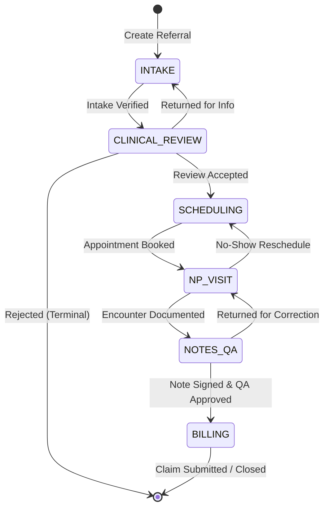

# Referrals Workflow Engine: Developer & Operational Guide

## 1. Architectural Overview

The **Heals on Wheels Referrals Workflow Engine** is an authoritative, transactional state machine engineered to govern clinical, operational, and billing lifecycles for mobile healthcare patient referrals.

### Core Architecture Principles
- **Authoritative Central Control**: State transitions cannot be bypassed by raw database updates; all pipeline transitions must pass through `WorkflowService.executeTransition()`.
- **Atomic Transactions**: Every transition, audit record (`WorkflowTransition`), assignment record (`ReferralAssignment`), and domain event (`EventOutbox`) commits within a single atomic PostgreSQL database transaction.
- **Optimistic Concurrency Control (OCC)**: Every referral has a numeric `version`. Updates and transitions must supply the client's known version; conflicting concurrent writes receive an immediate `409 Conflict`.
- **Idempotent Transition Execution**: Network retries using `x-idempotency-key` return identical cached results without duplicating state mutations or audit events. Tampered payloads using the same key are rejected with `409 Conflict`.
- **Transactional Outbox Event Stream**: Domain events are persisted atomically to `EventOutbox` and asynchronously dispatched by `OutboxProcessor` at regular intervals with retry backoff.
- **Hierarchical Multi-Tenant Scoping**: All operations are restricted by User Role Permissions (RBAC) and geographic/organizational scopes (`sites`, `states`, `legalEntities`).

---

## 2. Pipeline Stages & Allowed Transitions

### Pipeline Stages
1. `INTAKE`: Demographic capture, insurance payer verification, referral source intake.
2. `CLINICAL_REVIEW`: Provider review for medical necessity and admission eligibility.
3. `SCHEDULING`: Care coordination, patient outreach, mobile visit scheduling.
4. `NP_VISIT`: Mobile Nurse Practitioner home encounter and clinical documentation.
5. `NOTES_QA`: Quality assurance, coding review, and clinical note signature approval.
6. `BILLING`: Superbill/claim generation, payer submission, and revenue cycle processing.

### Allowed Forward and Backward Paths



### Operational Work Statuses
Within any stage, operational status reflects active workload state:
- `PENDING`: Queued, awaiting pickup.
- `IN_PROGRESS`: Actively worked by assigned specialist.
- `ON_HOLD`: Paused with scheduled follow-up date and documented reason.
- `BLOCKED_NEEDS_INFO`: Blocked pending external information (reason required).
- `COMPLETED`: Stage requirements fulfilled, ready for pipeline progression.

### Terminal Case Outcomes
When a referral concludes or is rejected, forward transitions are blocked:
- `REJECTED`: Ineligible, out-of-scope, or medical necessity criteria unmet.
- `PATIENT_DECLINED`: Patient or family refused mobile service.
- `DUPLICATE`: Identified duplicate referral entry.
- `DISCHARGED`: Care cycle completed.
- `CLOSED`: Administrative closure.

---

## 3. RBAC Permissions & Location Scoping

Each user has an assigned `UserRole` and location scoping arrays:

| Role | Primary Stage Ownership | Action Permissions |
|---|---|---|
| `INTAKE_SPECIALIST` | `INTAKE` | `referrals:create`, `referrals:read`, `referrals:update`, `referrals:transition:to_clinical_review` |
| `CLINICAL_REVIEWER` | `CLINICAL_REVIEW` | `referrals:transition:to_scheduling`, `referrals:transition:return_to_intake`, `referrals:transition:reject` |
| `CLINICAL_COORDINATOR` | `SCHEDULING` | `referrals:transition:to_np_visit`, `referrals:assign` |
| `NURSE_PRACTITIONER` | `NP_VISIT` | `referrals:transition:to_notes_qa`, `referrals:transition:return_to_scheduling` |
| `QA_DIRECTOR` | `NOTES_QA` | `referrals:transition:to_billing`, `referrals:transition:return_to_np_visit` |
| `BILLING_SPECIALIST` | `BILLING` | `referrals:transition:to_closed`, `referrals:read` |
| `SUPER_ADMIN` | All | Full permissions across all stages and actions |

### Multi-Tenant Location Scopes
A user is granted access only if the referral satisfies at least one matching criterion:
1. `SUPER_ADMIN` role: Access to all sites, states, and legal entities.
2. Wildcard scope (`*`): In `sites`, `states`, or `legalEntities`.
3. Explicit match: `user.sites.includes(referral.site)` OR `user.states.includes(referral.state)` OR `user.legalEntities.includes(referral.legalEntity)`.

---

## 4. Stage Transition Gates

Before any forward transition is executed, the `GatewayCheckService` performs strict validation gates:

| Transition | Prerequisite Checks |
|---|---|
| `INTAKE` &rarr; `CLINICAL_REVIEW` | Patient demographics complete, `insurancePayer` defined, `coverageVerified === true`. |
| `CLINICAL_REVIEW` &rarr; `SCHEDULING` | Active `ClinicalReview` record with `decision: 'ACCEPT'`. |
| `CLINICAL_REVIEW` &rarr; `INTAKE` (Return) | Non-empty `reason` documenting missing clinical information. |
| `CLINICAL_REVIEW` &rarr; (Reject) | `caseOutcome: 'REJECTED'` and valid rejection reason. |
| `SCHEDULING` &rarr; `NP_VISIT` | Active `Appointment` scheduled with assigned NP, date, and address. |
| `NP_VISIT` &rarr; `NOTES_QA` | Active `Encounter` with `dateOfService` and `servicesProvided`, and created `ClinicalNote`. |
| `NP_VISIT` &rarr; `SCHEDULING` (No-show) | Encounter marked `outcome: 'NO_SHOW'` or reason documented. |
| `NOTES_QA` &rarr; `BILLING` | `ClinicalNote` signed (`signedAt`, `signedById`), `billingStatus: 'READY'`. |
| `NOTES_QA` &rarr; `NP_VISIT` (Correction) | Return reason specified; routes reassignment back to originating NP. |

---

## 5. API Usage Examples

### 5.1 Execute Stage Transition

```bash
curl -X POST "https://api.healsonwheels.com/api/v1/referrals/780c1032-4113-4db0-9b43-9118e690040e/transitions" \
  -H "Authorization: Bearer <JWT_TOKEN>" \
  -H "Content-Type: application/json" \
  -H "x-idempotency-key: req-abc-12345" \
  -d '{
    "targetStage": "CLINICAL_REVIEW",
    "version": 1,
    "reason": "Intake completed and insurance coverage verified"
  }'
```

**Success Response (200 OK):**
```json
{
  "id": "780c1032-4113-4db0-9b43-9118e690040e",
  "pipelineStage": "CLINICAL_REVIEW",
  "workStatus": "PENDING",
  "version": 2,
  "assignedRole": "CLINICAL_REVIEWER",
  "updatedAt": "2026-10-26T16:00:00.000Z"
}
```

**Concurrency Conflict Response (409 Conflict):**
```json
{
  "statusCode": 409,
  "error": "Conflict",
  "message": "Referral was modified by another user. Current version: 2, provided version: 1",
  "currentVersion": 2
}
```

---

### 5.2 Update Operational Work Status

```bash
curl -X PATCH "https://api.healsonwheels.com/api/v1/referrals/780c1032-4113-4db0-9b43-9118e690040e/work-status" \
  -H "Authorization: Bearer <JWT_TOKEN>" \
  -H "Content-Type: application/json" \
  -d '{
    "workStatus": "BLOCKED_NEEDS_INFO",
    "version": 2,
    "reason": "Awaiting prior authorization approval from insurance carrier"
  }'
```

---

### 5.3 Assign Referral to Specialist or Role Queue

```bash
curl -X POST "https://api.healsonwheels.com/api/v1/referrals/780c1032-4113-4db0-9b43-9118e690040e/assignments" \
  -H "Authorization: Bearer <JWT_TOKEN>" \
  -H "Content-Type: application/json" \
  -d '{
    "userId": "98a1a457-4180-4ec3-a614-25eebc89d702",
    "reason": "Primary clinical reviewer assignment",
    "metadata": { "priority": "URGENT" }
  }'
```

---

### 5.4 Fetch Paginated Audit Trail

```bash
curl -X GET "https://api.healsonwheels.com/api/v1/referrals/780c1032-4113-4db0-9b43-9118e690040e/workflow-history?limit=10&offset=0" \
  -H "Authorization: Bearer <JWT_TOKEN>"
```

---

## 6. Outbox Background Service & Monitoring

1. **Scheduled Polling**: `OutboxProcessor` runs every 10 seconds (`*/10 * * * * *`).
2. **Batch Processing**: Retrieves up to 50 `PENDING` outbox records in chronological order.
3. **Exponential Backoff**: Failed events increment `retryCount` up to 5 attempts.
4. **Health Check & Latency Metrics**:
   - `GET /api/v1/health` verifies database, Redis, and outbox processor status.
   - P95 transition latency is monitored to remain `< 500ms`.
